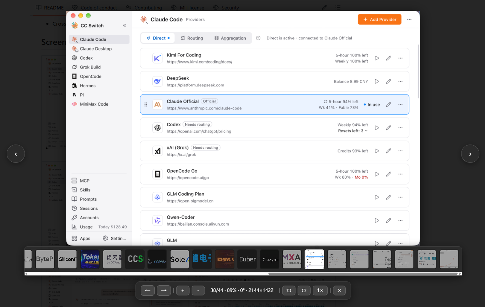
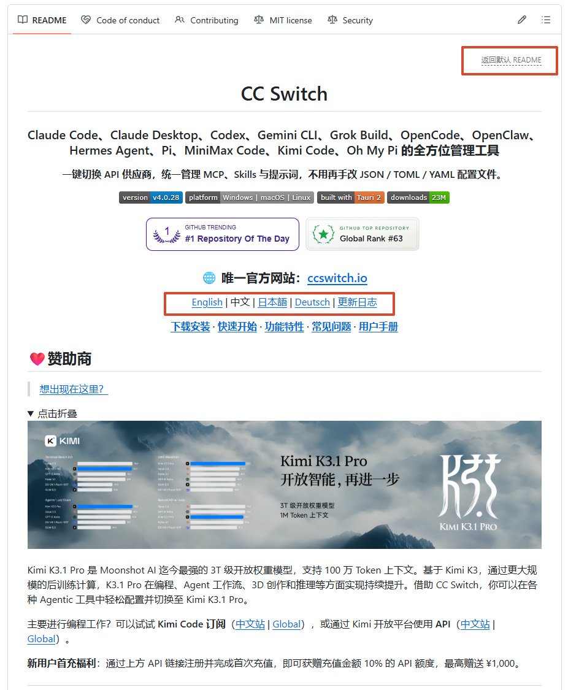

# GitHub README Enhancer

A userscript that enhances GitHub README pages with image previews and in-place multilingual README switching.

[简体中文](https://github.com/Moly6/github-readme-enhancer) | [English](README.en.md)

## Feature 1: Image Preview

- Click a Markdown image to open it in a full-screen preview.
- Browse images in the same Markdown section with previous and next controls.
- Zoom, rotate, and drag images; double-click to reset the view.
- View the image index, zoom level, rotation angle, and dimensions.
- Navigate images with a thumbnail strip.
- Excludes badge images whose `data-canonical-src` contains `img.shields.io` or `badge` (case-insensitive).
- Requires no extra permissions or third-party libraries.

## Feature 2: In-Place Multilingual README Switching

- On a GitHub repository homepage, click a link to another language README to load it in place without navigating away.
- Use the “Back to default README” link to return to the repository's default README.
- Relative image and link paths in the selected README are resolved correctly.

## Installation

1. Install Tampermonkey, Violentmonkey, or another compatible userscript manager.
2. Open the userscript manager's “Create a new script” page.
3. Open the [installation link](https://raw.githubusercontent.com/Moly6/github-readme-enhancer/main/github-readme-enhancer.js), or copy the contents of [`github-readme-enhancer.js`](./github-readme-enhancer.js) into the editor and save.
4. Open or refresh a GitHub page to use the features.

The script matches `github.com` and `gist.github.com`. Multilingual README switching is available only on GitHub repository homepages.

## Controls

| Action | Result |
| --- | --- |
| Click a Markdown image | Open the preview |
| Click an image wrapped in a link | Open the preview; Ctrl/Cmd-click or middle-click follows the link |
| Click a link to another language README | Switch README in place |
| `Esc` | Close the preview |
| `←` / `→` | Previous / next image |
| `[` / `]` | Rotate left / right by 90° |
| `+` / `=` or `-` | Zoom in / out |
| `0` | Reset zoom, rotation, and position |
| Mouse wheel | Zoom |
| Drag with the left mouse button | Move the image |
| Double-click the image | Toggle between 300% zoom and the reset view |

The preview toolbar provides zoom, rotation, reset, close, and image navigation controls. It also shows thumbnails when multiple images are available. The script checks for updates at a fixed Raw URL; userscript managers can detect a new version when the version number changes.

## License

This project is licensed under the MIT License. See [LICENSE](./LICENSE).
