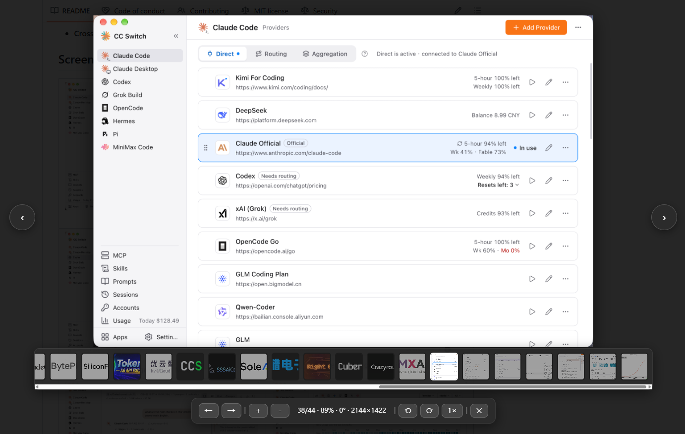
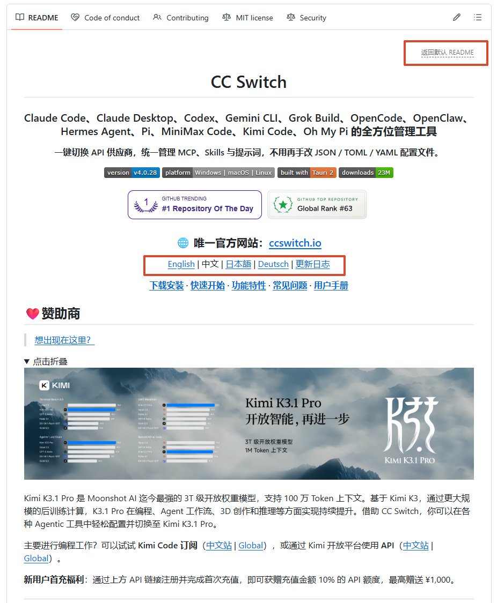

# GitHub README 增强工具

一个适用于 GitHub 的用户脚本，提供图片预览和多语言 README 原地切换两项功能。

## 功能一：图片预览

- 点击图片打开全屏预览。
- 同一 Markdown 内容区域中支持上一张、下一张循环浏览。
- 支持缩放、旋转和拖动图片；双击图片可重置视图。
- 显示当前图片序号、缩放比例、旋转角度和图片尺寸。
- 支持图片缩略图导航。
- 自动排除 `data-canonical-src` 中包含 `img.shields.io` 或 `badge`（不区分大小写）的图片，避免徽章进入预览和切换列表。
- 不请求额外权限，也不依赖第三方库。

## 功能二：多语言 README 原地切换

- 在 GitHub 仓库首页点击 README 中指向其他语言 README 文件的链接时，在当前页面原地加载内容，不跳转页面。
- 提供“返回默认 README”入口。
- 保留目标 README 中图片和链接的正确地址。

## 安装

1. 在浏览器中安装 Tampermonkey、Violentmonkey 或其他兼容的用户脚本管理器。
2. 打开脚本管理器的“新建脚本”页面。
3. 点击[脚本安装链接](https://raw.githubusercontent.com/Moly6/github-readme-enhancer/main/github-readme-enhancer.js)，或将 [`github-readme-enhancer.js`](./github-readme-enhancer.js) 的内容复制到脚本管理器并保存。
4. 打开或刷新 GitHub 页面，即可使用以上两项功能。

当前脚本头声明的匹配范围为 `github.com` 和 `gist.github.com`。多语言 README 切换只在 GitHub 仓库首页生效。

## 操作方式

| 操作 | 效果 |
| --- | --- |
| 点击 Markdown 图片 | 打开预览 |
| 点击被链接包裹的图片 | 普通点击打开预览；Ctrl/Cmd+点击或鼠标中键打开外层链接 |
| 点击 README 中的其他语言 README 链接 | 在当前页面切换 README |
| `Esc` | 关闭预览 |
| `←` / `→` | 切换上一张 / 下一张 |
| `[` / `]` | 向左 / 向右旋转 90° |
| `+` / `=`、`-` | 放大、缩小 |
| `0` | 重置缩放、旋转和位置 |
| 鼠标滚轮 | 缩放图片 |
| 按住鼠标左键拖动 | 移动图片 |
| 双击图片 | 在 300% 放大和重置视图间切换 |

预览工具栏提供放大、缩小、旋转、重置、关闭和图片切换按钮；“重置”会恢复缩放、旋转和位置，多张图片时还会显示缩略图导航。脚本通过固定的 Raw 文件地址检查更新，版本号提升后用户脚本管理器即可发现新版本。

## 许可证

本项目使用 MIT License，详见 [LICENSE](./LICENSE)。
